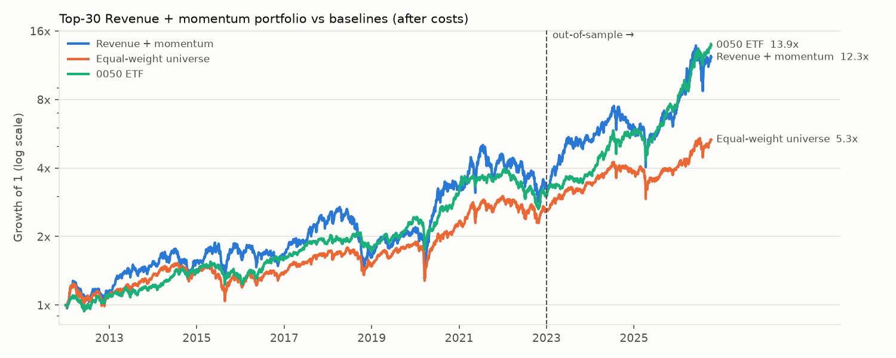

# twbt — 台股因子研究與回測框架

從資料下載、point-in-time 資料層、逐日回測引擎到研究報告，全部自己實作。用來回答一個問題：**台股公布月營收後，營收成長較快的公司，下個月股價是否表現較好？**

**[完整研究報告 →](docs/research/REPORT.md)**（由 `twbt research` 從資料自動產生，報告中沒有手打的數字）



## 結論（2012-01 ~ 2026-10，樣本外起點 2023-01）

- **訊號有效且穩健。**「營收成長 + 價格動能」把約 800 檔股票分成五組，最高組每月勝過最低組 1.2%（樣本內，t=3.4），樣本外 2.1%（t=3.9）。依流動性分層、在各產業內部重新排名後仍顯著，15 年中每一年最高組都勝過最低組。
- **可實際交易的 30 檔組合，超額報酬證據有限。**扣除成本後全期年化 18.5%，對照組全體等權重 12.0%、0050 19.5%。相對全體等權重，樣本內超額報酬 +4.3%（t=1.0，不顯著），樣本外 +19.9%（t=2.0，邊際顯著），而且樣本外是大多頭期間。波動（28%）和最大回撤（−52%）都明顯高於 0050。
- 也就是說：訊號裡有資訊，但以 25 萬本金、30 檔、月調倉的方式交易，大部分被集中持股的雜訊和成本吃掉。報告第 7 節有完整討論。

## 正確性：處理了哪些會讓回測變虛胖的問題

| 問題 | 處理方式 |
|---|---|
| 偷看未來（look-ahead） | 月營收只在申報期限（次月 10 日，遇假日順延）後的下一個交易日才能使用；策略只能透過 `Context` 取得當天以前的資料，從結構上無法讀到未來 |
| 存活者偏誤 | 股票池包含期間內下市的公司，下市時以最後收盤價結算 |
| 興櫃報價 | 依 FinMind 記錄的轉板日期，移除轉上市櫃前的興櫃報價，避免回測交易上市前、而且只有「後來成功上市」的股票 |
| 公司行動 | 除權息、減資、分割、面額變更統一成價值調整係數；成交用原始價格，持有跨過事件時調整股數 |
| 錯誤報價與漏記事件 | 超過漲跌幅限制、當天又沒有公司行動的跳動，研究期間共 3,277 筆（占股票日 0.05%），視為漏記的公司行動、價值中性處理（[稽核工具](src/twbt/research/audit.py)） |
| 交易限制 | 訊號在收盤產生、隔天開盤成交；開盤一價到底的漲停買不到、跌停賣不掉（2015-06 前 ±7%，之後 ±10%）；可選零股或整張 |
| 成本 | 手續費折扣與每筆最低手續費、證交稅（股票 0.3%、ETF 0.1%）、滑價 |
| 過度擬合 | 候選訊號的定義取自文獻、不調參數；選擇規則只看樣本內、事先寫定；所有候選的樣本外結果都列出；探索過程中看過全期資料、以及為修正錯誤重跑研究的經過，在報告中逐項揭露 |
| 重複記錄的公司行動 | 同一次面額變更同時出現在「分割」和「變更面額」兩張表，曾讓持股被放大 400 倍而不是 20 倍；同一天、同一個事件前價格的事件只套用一次 |
| 組合層級檢查 | 每檔持股單日漲跌最多 10%，所以組合單日變動超過 11% 一定是錯誤；研究流程會自動檢查並寫進報告。上面那個 bug 就是用這個檢查加上逐檔損益歸因找到的 |
| 可重現 | 查詢結果一律排序，同分時依股票代號決定；同樣資料跑兩次結果完全相同 |

每一項都有對應的測試（共 102 個），用假的 FinMind 伺服器和已知答案的合成資料，不需要網路。例如：把營收可用日提早一天，或把成交時點改成訊號當天收盤，測試都會失敗。

## 架構

```
FinMind API ─► data/raw     原樣保存、只追加；限流、可中斷續傳、增量更新
             ─► data/clean   point-in-time 整理；隨時可從 raw 重建
             ─► Data         DuckDB 查詢介面
             ─► MarketData   日期 × 股票的陣列，含總報酬指數
             ─► engine       逐日模擬：公司行動 → 下市 → 開盤成交 → 收盤評價 → 收盤後產生訊號
             ─► research     分組報酬、Rank IC、穩健性檢查、報告產生
```

```
src/twbt/
  data/        client.py（限流與重試）、update.py（續傳）、clean.py（時點規則與資料修正）、query.py
  engine/      engine.py、costs.py、context.py、market.py、metrics.py
  strategies/  revenue_momentum.py、momentum.py、combo.py
  research/    factor.py（分組與 IC）、study.py（研究流程）、report.py、audit.py
```

## 重現

```bash
pip install -e ".[dev]"
export FINMIND_TOKEN=...    # finmindtrade.com 免費註冊，每小時 600 次

twbt update                 # 第一次約 9,000 次呼叫，可隨時中斷，再執行一次就接著下載
twbt build                  # 整理成 clean 層
twbt research               # 產生 docs/research/
```

其他指令：`twbt search`（比較十個候選訊號、選出要實際交易的策略，產生 docs/strategy/）、`twbt backtest`（單一策略對 0050）、`twbt factor`（訊號版本比較）、`twbt audit`（資料稽核）、`twbt signal`（當月目標持股）、`twbt status`。

也可以不用自己的電腦：`.github/workflows/data.yml` 會在 GitHub Actions 上每天更新資料，並依需要執行研究流程。

## 限制

- 營收修正沒有版本紀錄，只保留最新值
- 現金股利在除息日入帳，未計股利稅與二代健保
- 成交價用開盤價加固定滑價，沒有模擬升降單位與成交量
- 下市以最後收盤價結算，對倒閉公司偏樂觀
- 樣本外只有約 3.8 年，而且是大多頭期間

資料來源：[FinMind](https://finmind.github.io/)。依其授權，本專案不包含任何原始資料。
