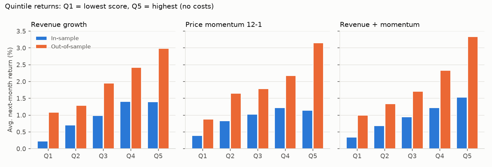
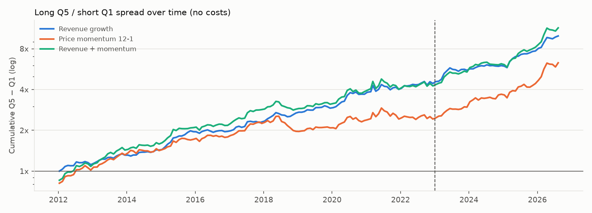

# 研究報告：台股月營收與價格動能

> 本報告由 `twbt research` 自動產生，所有數字都直接來自資料。
> 資料期間 2012-01-01 ~ 2026-10-08；樣本外起點 2023-01-01。

## 摘要

- 樣本內 Q5−Q1 月報酬差與 t 值：月營收成長 +1.18%（t=4.63）；價格動能 12-1 +0.75%（t=2.17）；營收 + 動能 +1.18%（t=3.41，各組單調遞增）。
- 依事先訂好的規則（樣本內 top-30 組合的 Sharpe 最高）選出 **營收 + 動能**。
- 選出的訊號在樣本外：Q5−Q1 平均每月 +2.34%
  （t=3.92），Rank IC +0.027
  （t=1.86）。
- Top-30 組合扣除成本後，全期年化 24.0%，
  全體等權重 12.3%，0050 19.5%；
  樣本外分別為 69.8%、22.3%、
  49.9%。

## 1. 研究問題

月營收是台股特有、每月公布的基本面資料。問題是：**公布當下營收成長較快的公司，
下個月股價表現是否較好？** 結合價格動能能否改善？

## 2. 資料與方法

- **資料**：FinMind 日價格、月營收、除權息與減資等公司行動，含 2012 年後下市的公司
  （避免存活者偏誤）；依 FinMind 記錄的轉板日期移除轉上市櫃前的興櫃報價；排除創新板。
- **時點**：月營收只在申報期限（次月 10 日，遇假日順延）之後的下一個交易日才能使用；
  晚於期限申報者以資料實際出現日的下一個交易日為準。策略程式碼只能透過
  `Context` 取得當天以前已公開的資料。
- **資料清理**：上市櫃股票單日漲跌幅上限 10%（2015-06-01 前 7%）。超過上限、當天又沒有
  任何公司行動的跳動，幾乎都是錯誤報價或漏記的減資、面額變更。研究期間共
  3,277 筆（占 6,180,371 個股票日的 0.053%），
  一律視為漏記的公司行動處理：持有人資產價值不變，不當作獲利或虧損。
  未處理時，動能類策略會傾向買進這些假漲幅。
- **股票池**：上市櫃普通股，20 日平均成交值 ≥ 1,000 萬元，排除建材營造業
  （交屋時一次認列營收，年增率反映的是交屋時點而非成長）。
- **調倉**：每月 11 日後第一個交易日收盤產生訊號，**隔天開盤**成交。
- **成本**：手續費 0.1425% × 2.8 折、每筆最低 20 元，賣出證交稅 0.3%，
  每邊滑價 0.1%；開盤一價到底的漲跌停無法成交；下市以最後收盤價結算。

### 候選訊號（事先依文獻決定）

| 代號 | 定義 |
|---|---|
| 月營收成長 | 最近 3 個已公布月份營收合計 ÷ 去年同期 3 個月合計 − 1 |
| 價格動能 12-1 | 過去 252 個交易日到 21 個交易日前的總報酬（跳過最近一個月，避開短期反轉） |
| 營收 + 動能 | 兩者在當期股票池內百分位排名的平均 |

### 研究程序與揭露

- 樣本內：2012-01-01 ~ 2023-01-01 前；樣本外：2023-01-01 起，**只在最後跑一次**。
- 選擇規則事先訂好：樣本內 top-30 組合 Sharpe 最高者。三個候選的樣本外結果全部列出。
- 誠實揭露：在這份正式研究之前，曾用全期資料做過探索，並據此決定了三件事：
  營收用「3 個月合計」而非單月年增率平均、排除建材營造業、持股 30 檔而非 8 檔。
  因此樣本外期間並非完全沒被看過，結果應視為偏樂觀的上限。

## 3. 訊號檢驗：分組報酬

每期把股票池依分數由低到高平均分成 5 組，計算各組等權重到下次調倉的總報酬
（含息、不計成本）。



| 訊號 | 期間 | Q1 | Q2 | Q3 | Q4 | Q5 | Q5−Q1 | t | Rank IC | IC t | IC>0 |
|---|---|---|---|---|---|---|---|---|---|---|---|
| 月營收成長 | 樣本內 (132 期) | +0.22% | +0.71% | +0.99% | +1.40% | +1.40% | +1.18% | 4.63 | +0.035 | 4.22 | 65% |
| 月營收成長 | 樣本外 (44 期) | +1.09% | +1.29% | +1.95% | +2.42% | +2.98% | +1.90% | 3.95 | +0.027 | 2.10 | 64% |
| 價格動能 12-1 | 樣本內 (132 期) | +0.39% | +0.83% | +1.03% | +1.22% | +1.14% | +0.75% | 2.17 | +0.016 | 1.36 | 58% |
| 價格動能 12-1 | 樣本外 (44 期) | +0.88% | +1.65% | +1.78% | +2.18% | +3.15% | +2.27% | 3.67 | +0.018 | 1.14 | 52% |
| 營收 + 動能 | 樣本內 (132 期) | +0.35% | +0.68% | +0.94% | +1.22% | +1.53% | +1.18% | 3.41 | +0.032 | 2.80 | 61% |
| 營收 + 動能 | 樣本外 (44 期) | +1.00% | +1.34% | +1.71% | +2.34% | +3.34% | +2.34% | 3.92 | +0.027 | 1.86 | 66% |



## 4. 投資組合：Top-30，含成本


| 組合 | 期間 | 年化報酬 | 年化波動 | Sharpe | 最大回撤 | 對全體等權重的超額報酬 | IR | t |
|---|---|---|---|---|---|---|---|---|
| 月營收成長 | 樣本內 | 3.2% | 22.5% | 0.25 | -45.7% | -4.4% | -0.43 | -1.41 |
| 月營收成長 | 樣本外 | 43.1% | 47.3% | 0.96 | -28.2% | +22.9% | 0.52 | 1.01 |
| 月營收成長 | 全期 | 12.2% | 30.7% | 0.51 | -45.7% | +2.5% | 0.10 | 0.40 |
| 價格動能 12-1 | 樣本內 | 7.8% | 26.8% | 0.42 | -55.1% | +1.1% | 0.07 | 0.24 |
| 價格動能 12-1 | 樣本外 | 55.6% | 53.2% | 1.06 | -42.2% | +34.3% | 0.72 | 1.38 |
| 價格動能 12-1 | 全期 | 18.4% | 35.4% | 0.64 | -55.1% | +9.4% | 0.35 | 1.33 |
| 營收 + 動能 | 樣本內 | 11.3% | 26.5% | 0.54 | -51.7% | +4.2% | 0.30 | 0.99 |
| 營收 + 動能 | 樣本外 | 69.8% | 53.8% | 1.21 | -37.0% | +43.1% | 0.88 | 1.70 |
| 營收 + 動能 | 全期 | 24.0% | 35.4% | 0.76 | -51.7% | +14.0% | 0.51 | 1.96 |
| 全體等權重 | 樣本內 | 9.1% | 16.4% | 0.61 | -32.6% | – | – | – |
| 全體等權重 | 樣本外 | 22.3% | 18.8% | 1.18 | -30.0% | – | – | – |
| 全體等權重 | 全期 | 12.3% | 17.1% | 0.77 | -32.6% | – | – | – |
| 0050 | 樣本內 | 10.5% | 16.0% | 0.71 | -34.0% | +1.2% | 0.09 | 0.31 |
| 0050 | 樣本外 | 49.9% | 23.7% | 1.85 | -27.5% | +21.8% | 1.22 | 2.36 |
| 0050 | 全期 | 19.5% | 18.3% | 1.07 | -34.0% | +6.4% | 0.45 | 1.73 |

「對全體等權重的超額報酬」是相對於同一股票池的等權重指數。這個指數**不計任何成本**
（以 25 萬本金持有約 800 檔、每筆最低手續費 20 元，實際上無法交易），
所以是比含成本組合更嚴格的基準，是判斷選股能力的主要依據。0050 約一半是台積電，主要反映大型權值股的表現，作為參考。

## 5. 穩健性

### 5.1 是否只是小型股效應？依流動性分三層，各層內部再分組

| 訊號 | 流動性 | 平均檔數 | Q5−Q1 月報酬 | t | Rank IC |
|---|---|---|---|---|---|
| 月營收成長 | 低 | 265 | +1.27% | 5.88 | +0.046 |
| 月營收成長 | 中 | 265 | +1.28% | 5.35 | +0.033 |
| 月營收成長 | 高 | 267 | +1.58% | 4.24 | +0.025 |
| 價格動能 12-1 | 低 | 273 | +1.02% | 3.48 | +0.034 |
| 價格動能 12-1 | 中 | 272 | +0.89% | 2.92 | +0.017 |
| 價格動能 12-1 | 高 | 275 | +1.25% | 2.93 | +0.004 |
| 營收 + 動能 | 低 | 264 | +1.45% | 5.03 | +0.049 |
| 營收 + 動能 | 中 | 265 | +1.26% | 4.18 | +0.032 |
| 營收 + 動能 | 高 | 267 | +1.69% | 3.96 | +0.019 |

### 5.2 逐年：營收 + 動能 的 Q5 − Q1（全期，不計成本）

| 2012 | 2013 | 2014 | 2015 | 2016 | 2017 | 2018 | 2019 | 2020 | 2021 | 2022 | 2023 | 2024 | 2025 | 2026 |
|---|---|---|---|---|---|---|---|---|---|---|---|---|---|---|
| +16.0% | +34.5% | +10.5% | +26.3% | +5.8% | +33.4% | +0.2% | +11.6% | +28.3% | +2.4% | +5.5% | +30.8% | +15.1% | +40.1% | +41.5% |

15 年中有 15 年 Q5 勝過 Q1。

### 5.3 是否只是押對產業？在每個產業內部重新排名

| 期間 | Q5−Q1 月報酬 | t | Rank IC | IC t |
|---|---|---|---|---|
| 樣本內 | +1.16% | 4.42 | +0.033 | 3.48 |
| 樣本外 | +2.19% | 4.71 | +0.024 | 2.07 |
| 全期 | +1.42% | 6.15 | +0.030 | 4.01 |

### 5.4 多頭月與空頭月（以全體等權重當月漲跌區分）

| 市場 | 月數 | 全體平均月報酬 | Q5−Q1 月報酬 | t |
|---|---|---|---|---|
| 上漲月 | 114 | +4.04% | +1.77% | 4.74 |
| 下跌月 | 62 | -4.11% | +0.92% | 1.82 |

### 5.5 持股數與手續費敏感度（營收 + 動能）

| 持股數 | 手續費 | 全期年化 | 全期 Sharpe | 樣本內年化 | 樣本外年化 | 年換手率 | 成本合計 |
|---|---|---|---|---|---|---|---|
| 10 | 2.8折 | 16.1% | 0.39 | -4.8% | 107.4% | 4.3x | 127,307 |
| 10 | 原價 | 15.5% | 0.39 | -5.2% | 105.7% | 4.3x | 158,329 |
| 30 | 2.8折 | 24.0% | 0.76 | 11.3% | 69.8% | 3.8x | 319,463 |
| 30 | 原價 | 23.7% | 0.76 | 11.2% | 68.8% | 3.8x | 391,823 |
| 50 | 2.8折 | 23.1% | 0.86 | 11.9% | 62.5% | 3.6x | 377,624 |
| 50 | 原價 | 22.9% | 0.85 | 11.9% | 61.8% | 3.6x | 424,396 |

## 7. 結論

**訊號本身：有效，而且在樣本外與各流動性層都成立。**
- 營收 + 動能的 Q5−Q1 價差：樣本內每月 +1.18%（t=3.41，顯著），樣本外每月 +2.34%（t=3.92，顯著）。
- 依流動性分三層、在每層內部重新分組，最小的 t 值為 3.96，訊號不只是小型股效應。
- 全期 15 年中有 15 年 Q5 勝過 Q1。
- 在每個產業內部重新排名後，全期 t=6.15，訊號不是單純押對產業。
- 下跌月（62 個月）的價差每月 +0.92%（t=1.82），上漲月 +1.77%（t=4.74）。

**可實際交易的 top-30 組合（含成本）：超額報酬在樣本內外都不顯著。**
- 相對全體等權重指數（不計成本）的年化超額報酬：樣本內 +4.2%（t=0.99），樣本外 +43.1%（t=1.70）。
- 樣本外期間市場明顯較強：全體等權重年化 22.3%（樣本內 9.1%），0050 49.9%。組合樣本外年化 69.8% 有相當部分來自市場本身，不應當作未來可預期的報酬。
- 風險：全期年化波動 35.4%（0050 18.3%），最大回撤 -51.7%（0050 -34.0%）；Sharpe 0.76，低於 0050 的 1.07，波動明顯較大。
- 成本：以 250,000 元分成 30 檔，每筆約 8,333 元，最低手續費 20 元約占 0.24%，高於 2.8 折後的費率，所以折扣幾乎沒有效果；本金越大，成本比例越低。

**下一步**：累積更長的樣本外期間；以產業中性的版本建構組合，並測試較大本金下的成本與容量。

## 8. 限制

- 營收修正沒有版本紀錄，只保留最新值；早期的申報時點只能依法定期限推估。
- 現金股利在除息日入帳；未計股利稅、二代健保補充保費。
- 成交價用開盤價加固定滑價，沒有模擬升降單位與開盤成交量是否足夠。
- 下市以最後收盤價結算，對倒閉公司偏樂觀。
- 只有一段樣本外期間（約 3.8 年），統計檢定力有限。

## 9. 重現

```bash
twbt update && twbt build
twbt research --out docs/research
```
